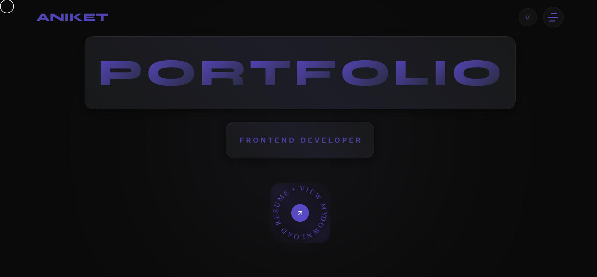

# 🎨 Modern React Portfolio Website

<div align="center">
  


  <p align="center">
    A modern, responsive portfolio website built with React, featuring dynamic themes, smooth animations, and an intuitive user interface.
    <br />
    <a href="https://your-portfolio-url.com"><strong>View Demo »</strong></a>
  </p>
</div>

## ✨ Features

<details>
<summary>Dynamic Theming 🌓</summary>

- Light/Dark mode toggle with smooth transitions
- Custom accent color generation
- Responsive design across all devices
- Theme-aware components
</details>

<details>
<summary>Interactive Elements 🎯</summary>

- Animated text effects
- Floating cards with hover effects
- Custom cursor implementation
- Smooth scrolling navigation
- Dynamic grid backgrounds
</details>

<details>
<summary>Project Showcase 🚀</summary>

- **Netflix GPT** - React, Redux, Firebase
- **Disease Prediction App** - Python, Streamlit
- **OBYS UI Clone** - HTML, CSS, JavaScript
- **Weather App** - HTML, CSS, JavaScript
- **UI/UX Designs** - Figma
</details>

## 🛠️ Tech Stack


## 📱 Responsive Design

```css
Desktop (1200px+) │ Laptop (1024px) │ Tablet (768px) │ Mobile (480px) │ Small Mobile (320px)

```

## 📄 Project Structure
```
portfolio/
├── src/
│   ├── assets/
│   ├── components/
│   ├── context/
│   ├── styles/
│   └── App.jsx
├── public/
├── index.html
└── package.json
```


### Technical Features
- Responsive layouts using CSS Grid and Flexbox
- CSS Variables for theme management
- Performance optimized animations
- Accessibility compliant
- Cross-browser compatibility

## 🛠️ Technologies Used

### Frontend
- React.js
- CSS3 with Modern Features
- JavaScript ES6+
- Context API for State Management

### Design & Animation
- CSS Custom Properties
- CSS Grid/Flexbox
- CSS Animations
- SVG Animations

### Development Tools
- Vite
- Git & GitHub
- VS Code
- Figma

## 📱 Responsive Design
- Desktop (1200px+)
- Laptop (1024px)
- Tablet (768px)
- Mobile (480px)
- Small Mobile (320px)

## ⚡ Performance Features
- Lazy loading images
- Optimized animations
- Reduced motion support
- Efficient state management
- Memoized components

## 🎨 Design Features
- Modern minimalist interface
- Smooth transitions
- Interactive elements
- Custom animations
- Professional typography

## 🔍 SEO & Accessibility
- Semantic HTML
- ARIA labels
- Alt text for images
- Color contrast compliance
- Keyboard navigation support

## 🔧 Installation & Setup

```bash
# Clone the repository
git clone https://github.com/aniketkumar7/Modern_Portfolio

# Navigate to project directory
cd portfolio

# Install dependencies
npm install

# Start development server
npm run dev

# Build for production
npm run build

```

## 🌐 Browser Support
- Chrome (latest)
- Firefox (latest)
- Safari (latest)
- Edge (latest)
- Opera (latest)


## 🎯 Future Enhancements
- Add blog section
- Implement contact form
- Add more project animations
- Enhance mobile interactions
- Add more theme options

## 📫 Contact
- LinkedIn: [Your LinkedIn](https://www.linkedin.com/in/aniketkumar07/)
- Email: aniketkumar639597@gmail.com

## 📝 License
This project is open source and available under the [MIT License](LICENSE).

---

⭐ Star this repo if you find it helpful!


Save this content in a file named `README.md` at the root of your project. Remember to:
1. Replace "yourusername" with your actual GitHub username
2. Update the contact information with your actual details
3. Add any specific installation instructions if needed
4. Update the project structure if it differs from your actual structure
5. Add any additional sections that might be relevant to your project

The markdown format will automatically r
